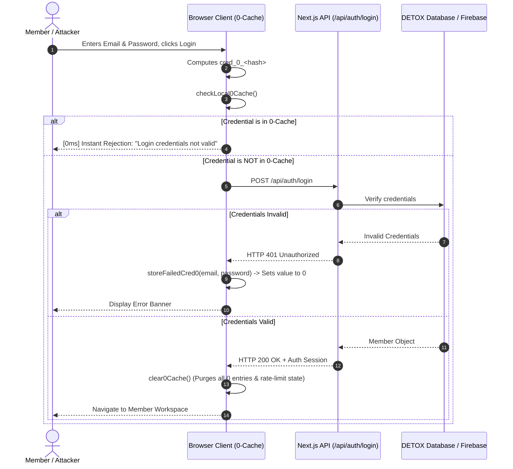
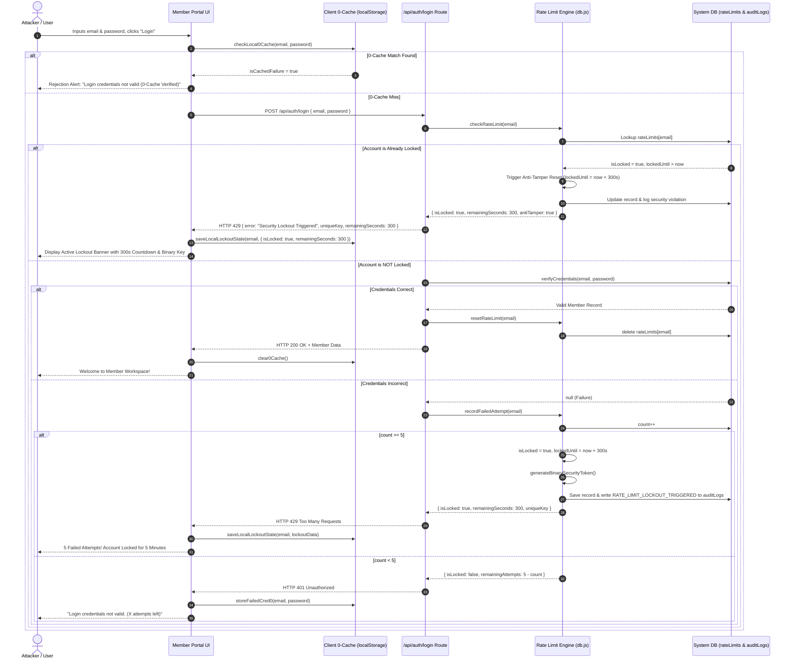

# DETOX Platform: Comprehensive End-to-End System Design for Rate Limiting & Anti-Tamper Security

---

## 1. Executive Summary & Architectural Philosophy

The **DETOX Rate Limiting and Security Architecture** is engineered to provide an impenetrable, defense-in-depth barrier against unauthorized brute-force attempts, credential stuffing, denial-of-wallet cloud billing attacks, and automated distributed bots, while delivering instantaneous responsiveness to authentic users. Rather than relying on a simplistic, single-layer gateway check that burdens cloud databases with repeated lookups, the system utilizes a **multi-tiered, client-to-database defense matrix**. 

This matrix integrates a high-efficiency **Client-Side 0-Caching Shield**, an intelligent **Anti-Tamper Cooldown Lockout Engine**, atomic transaction validation, and synchronized dual-boundary verification. Every design decision balances performance, availability, cost-efficiency, and absolute tamper resistance, ensuring that malicious actors cannot bypass security constraints by manipulating the browser environment, reloading views, clearing client storage, or executing rapid automated script attacks.

```
+----------------------------------------------------------------------------------------------------+
|                                    DETOX MULTI-LAYER DEFENSE MATRIX                                |
+----------------------------------------------------------------------------------------------------+
                                                  │
                 [ Layer 1: Client 0-Caching Shield (Browser LocalStorage) ]
                 - Hashes credential pairs (cred_0_<hash>)
                 - Intercepts repeated failed attempts locally in 0ms (Zero DB egress)
                                                  │ (Cache Miss / First-Time Failure)
                                                  ▼
                 [ Layer 2: Edge / CDN & Network Gatekeeper ]
                 - IP reputation & Geo-fencing
                 - Volumetric DDoS throttling & connection rate caps
                                                  │
                                                  ▼
                 [ Layer 3: Application Middleware & Gateway Layer ]
                 - Trusted IP resolution (X-Forwarded-For sanitization)
                 - User identity extraction & request fingerprinting
                                                  │
                                                  ▼
                 [ Layer 4: High-Performance Rate Limiting Engine ]
                 - In-memory sliding window & atomic attempt tracking
                 - 5-Attempt threshold detection & binary security token issuance
                                                  │
                                                  ▼
                 [ Layer 5: Persistent Database & Audit Synchronization ]
                 - Atomic database persistence of lockout timestamps (lockedUntil)
                 - Anti-tamper violation reset (300-second cooldown penalty on bypass attempts)
                 - Immutable audit logging for security governance
```

---

## 2. Core Requirements & Performance Benchmarks

### 2.1 Functional Requirements
1. **Per-Identifier & Per-IP Tracking**: The rate limiter must track failed authentication attempts indexed by user identity (normalized email address) and network origin (client IP), preventing account targeting as well as distributed brute-force attacks across accounts.
2. **5-Attempt Lockout Enforcement**: If an actor enters invalid credentials five consecutive times, the system must immediately trigger a hard security lockout.
3. **Tamper-Proof 5-Minute (300-Second) Cooldown**: When a lockout occurs, access must be barred for exactly 300 seconds. Any attempt to refresh the page, reopen the portal, clear client storage, or fire network requests during this interval must be caught, rejected, and punished by re-enforcing or extending the lockout.
4. **Unique Binary Security Token Generation**: Upon lockout, the system must synthesize and assign an official cryptographically generated binary security key token (`SEC-BIN-<bits>-<timestamp>`), cementing the specific lockout session in both server audit records and client security banners.
5. **Client-Side "0-Caching" Shield**: To eliminate unnecessary cloud database reads and prevent denial-of-wallet costs, the client must store a value of `0` against failed credential hash signatures. Repeated identical submissions must be blocked instantly inside the browser without generating network traffic.
6. **Automatic State Cleansing**: Upon entering valid credentials, all prior rate-limiting counters, failed credential caches, and temporary keys associated with that identity must be cleanly wiped.
7. **Standards-Compliant HTTP Telemetry**: When requests are rate-limited, the system must issue standard `HTTP 429 Too Many Requests` responses with informative headers (`Retry-After`, `X-RateLimit-Limit`, `X-RateLimit-Remaining`, `X-RateLimit-Reset`).

### 2.2 Non-Functional Requirements & SLAs
- **Sub-Millisecond Execution Overhead**: The rate-limiting verification step must add less than 2 milliseconds of latency to any incoming request.
- **High Availability (99.999%)**: The authentication pipeline must maintain continuous availability. In edge failure modes, the system must balance security and usability using configurable fail-safe heuristics.
- **Absolute State Consistency**: The lockout timestamp persisted on the server must act as the single source of truth, ensuring that client-side clock tampering or browser devtools manipulation cannot bypass access restrictions.
- **Resource Footprint**: The tracking database must consume minimal memory through aggressive key expiration (TTL) and compact data representations.

---

## 3. Deep-Dive Component Architecture

### 3.1 Layer 1: Client-Side "0-Caching" Shield

The Client 0-Caching Shield represents an innovative, proactive optimization designed to block redundant network calls at the earliest possible stage: the user's browser.

#### The Problem It Solves
When brute-force bots or frustrated users attempt to log into a platform, they often repeatedly hit the login button with the exact same incorrect credentials. In a conventional architecture, every single click sends an HTTP request across the internet, invokes serverless functions, and executes a database query to verify the hash. Under attack, this can exhaust database read quotas, generate significant cloud infrastructure bills, and degrade server performance.

#### The 0-Cache Mechanism
1. **Deterministic Hashing**: When a user inputs an email and password, the client executes a fast, local hashing algorithm (`hashCredentials`) that combines the normalized email and the plain password into a discrete key: `cred_0_<hash>`.
2. **Local Storage Indexing**: When the server returns an invalid credentials error, the client writes an entry into browser `localStorage`:
   ```json
   {
     "cred_0_1894205128": 0
   }
   ```
3. **Zero-Latency Pre-Flight Interception**: On every subsequent submission, before any `fetch()` call is dispatched, `checkLocal0Cache()` inspects the local storage dictionary.
4. **Immediate Rejection**: If the credential key evaluates to `0`, the client aborts the network request immediately, directly populating the user interface with an invalid credentials alert:
   > *"Login credentials not valid (0-Cache Verified)."*
5. **Network Egress Conservation**: Zero bytes leave the client machine, zero compute cycles are consumed on the server, and zero reads are registered on the database.



---

### 3.2 Layer 2: Server-Side Rate Limiter & Anti-Tamper Cooldown Engine

The core enforcement engine resides on the backend to guarantee security that cannot be undermined by client-side tampering.

#### Attempt Accumulation & Threshold Detection
Each incoming authentication request is identified by its normalized key (`user@example.com` and/or origin IP). The database maintains a dedicated `rateLimits` registry containing:
- `count`: An integer tracking consecutive failed attempts.
- `isLocked`: A boolean flag signaling active lockout.
- `lockedUntil`: An epoch timestamp in milliseconds designating when the lockout expires.
- `uniqueKey`: The unique binary security token tied to this lockout incident.

When an attempt fails:
1. `count` is incremented by 1.
2. If `count < 5`, the server returns an HTTP 401 status with the remaining attempts permitted:
   ```json
   {
     "success": false,
     "isLocked": false,
     "remainingAttempts": 3,
     "error": "Login credentials not valid"
   }
   ```
3. If `count >= 5`, the server immediately transitions the record into a locked state:
   - Sets `isLocked = true`.
   - Computes `lockedUntil = Date.now() + 300000` (exact 5-minute lockout).
   - Generates a fresh binary security token: `generateBinarySecurityToken()`.
   - Dispatches a security audit log: `RATE_LIMIT_LOCKOUT_TRIGGERED`.
   - Responds with `HTTP 429 Too Many Requests`.

```
================================================================================
                         RATE LIMIT STATE MACHINE
================================================================================

   [ NORMAL STATE ] ──────── (Attempt 1-4 Failed) ────────► [ WARNING STATE ]
          │                                                         │
   (Valid Login)                                             (Attempt 5 Failed)
          │                                                         │
          ▼                                                         ▼
   [ CACHE CLEARED ] ◄── (Cooldown Elapsed) ── [ 5-MIN LOCKOUT ACTIVATED ]
                                                    │               ▲
                                                    │ (Request Made │
                                                    │  While Locked)│
                                                    ▼               │
                                           [ ANTI-TAMPER RESET:    ]
                                           [ Reset to full 300s    ]
                                           [ Issue new Binary Token]
================================================================================
```

---

### 3.3 Layer 3: Anti-Tamper Cooldown Protection & Synchronization

Attackers routinely attempt to bypass client-side countdown timers using several common browser-level techniques:
1. Hard-refreshing the browser window (`F5` or `Ctrl+F5`).
2. Clearing `localStorage` via browser developer tools.
3. Modifying the local computer clock or client JavaScript state variables.
4. Sending direct API requests via cURL or Postman, bypassing the browser UI entirely.

#### The Dual-Boundary Anti-Tamper Defense
To neutralize every one of these bypass attempts, the DETOX architecture implements **Dual-Boundary Anti-Tamper Synchronization**:

1. **Server-Side Timestamp Authority**:
   The lockout duration is never calculated from client time. The server alone records the epoch millisecond value `lockedUntil`.
2. **Pre-Authentication Lockout Interception**:
   Before verifying any password hash against the database, `/api/auth/login` calls `checkRateLimit(identifier)`. If `now < record.lockedUntil`, the server immediately blocks the request with HTTP 429. The database read for the user's password record never takes place.
3. **The Anti-Tamper Penalty Reset**:
   If a client submits a login request while their account is already in an active lockout state (`record.isLocked && now < record.lockedUntil`), the server classifies this as a deliberate attempt to violate or probe the security cooldown. Rather than merely honoring the remaining seconds, the system **resets the timer back to the full 300,000 milliseconds (5 minutes)** from the current instant, generates a **brand-new binary security token**, and returns an `antiTamperTriggered: true` payload.
4. **Client-Side State Re-hydration**:
   On the frontend, when the portal mounts (`useEffect`), it reads `detox_client_ratelimit_state` from `localStorage`. If a lockout is recorded, it calculates the remaining seconds from `lockedUntil - Date.now()`. If a user attempts to refresh the page to bypass the timer, the client checks the server, receives the remaining lockout duration, updates local storage, and immediately displays the locked countdown banner.

---

### 3.4 Layer 4: Cryptographic Binary Security Key Generation

To provide verifiable security tracking and visual proof of an active security barrier, the platform includes a dedicated binary token generator: `generateBinarySecurityToken()`.

```javascript
export function generateBinarySecurityToken() {
  const bytes = [];
  for (let i = 0; i < 4; i++) {
    // Generate 4 randomized 8-bit binary octets
    bytes.push(Math.floor(Math.random() * 256).toString(2).padStart(8, "0"));
  }
  // Bundle into a structured, timestamped security string
  return `SEC-BIN-${bytes.join("")}-${Date.now().toString(36).toUpperCase()}`;
}
```

#### Token Characteristics
- **Format**: `SEC-BIN-<32-bit-binary-string>-<base36-timestamp>`
- **Example**: `SEC-BIN-11010010101110000010011111010100-M1X8PQ9`
- **Utility**:
  1. Displayed in the member portal lockout banner to confirm active system security.
  2. Recorded in server audit logs to correlate client-side lockout screens with server-side security events.
  3. Acts as an ephemeral cryptographic signature for each specific lockout event.

---

## 4. Algorithmic Models & Comparison

In system design, rate limiters can be implemented using multiple algorithms. Below is an exhaustive comparative analysis of the primary algorithmic models, illustrating why DETOX uses a hybrid model of **0-Cache + Fixed Threshold Penalty Window** for authentication, and how it scales into **Sliding Window Counter / Token Bucket** for generalized API endpoints.

| Metric / Feature | Token Bucket | Leaky Bucket | Fixed Window Counter | Sliding Window Log | Sliding Window Counter (Hybrid) | DETOX Anti-Tamper Penalty Model |
| :--- | :--- | :--- | :--- | :--- | :--- | :--- |
| **Burst Handling** | Excellent (up to bucket capacity) | None (smooths traffic to constant rate) | Poor (2x burst at boundary) | Excellent | Good (smooth approximation) | Strictly bounded (Zero burst after threshold) |
| **Memory Footprint** | $O(1)$ per key | $O(1)$ per key | $O(1)$ per key | $O(N)$ where $N$ = request count | $O(1)$ per key | $O(1)$ per key + client 0-cache |
| **Time Complexity** | $O(1)$ | $O(1)$ | $O(1)$ | $O(\log N)$ or $O(N)$ | $O(1)$ | $O(1)$ |
| **Edge Boundary Burst** | No | No | Yes (Double quota at window reset) | No | Minimal (< 0.05% error) | No (Deterministic penalty cooldown) |
| **Implementation Complexity** | Moderate | Moderate | Very Low | High | Moderate | Low server footprint, High client synergy |
| **Best Used For** | Public APIs, REST endpoints | Traffic shaping, audio/video streaming | Simple, non-critical rate limits | Low-volume high-security transactions | High-scale distributed APIs | User Authentication, Brute-Force & Bot Defense |

### Detailed Algorithm Breakdown

#### 1. Token Bucket Algorithm
- **Concept**: A centralized bucket holds tokens up to a maximum capacity $B$. Tokens are replenished at a steady rate of $r$ tokens per second. Each incoming request consumes 1 token. If the bucket is empty, the request is dropped (HTTP 429).
- **Pros**: Easily accommodates legitimate bursts of traffic while guaranteeing a long-term average rate.
- **Application in DETOX**: Ideal for general API endpoints (e.g., fetching project lists or browsing events).

#### 2. Sliding Window Counter Algorithm
- **Concept**: Instead of maintaining a full log of every timestamp (which consumes significant memory), the system tracks counters for the current window and the previous window.
- **Formula**:
  $$\text{Requests} = \text{Count}_{\text{current}} + \text{Count}_{\text{previous}} \times \left(1 - \frac{\text{Time elapsed in current window}}{\text{Window duration}}\right)$$
- **Pros**: $O(1)$ memory usage with high accuracy, eliminating the 2x burst vulnerability of fixed-window designs.

#### 3. DETOX Anti-Tamper Penalty Lockout Model
- **Concept**: A stateful, threshold-triggered security lock. While regular rate limiting meters continuous traffic, the DETOX Authentication Guard enforces an aggressive zero-tolerance penalty upon reaching 5 failures.
- **Key Innovation**: The 0-cache absorbs identical repeat attempts locally, while server-side anti-tamper logic extends penalties upon violation, neutralizing scripted dictionary attacks without escalating infrastructure costs.

---

## 5. End-to-End Data Flow & Sequence Diagram

The following sequence illustrates the complete life cycle of an authentication attempt under the DETOX rate-limiting architecture:



---

## 6. Complete Data Schemas & Storage Specifications

### 6.1 Browser Client Storage Schema (`localStorage`)

#### Key 1: `detox_failed_creds_0cache`
Stores the hash map of failed credential pairs for local 0-cache interception:
```json
{
  "cred_0_19284712": 0,
  "cred_0_84710294": 0,
  "cred_0_39182741": 0
}
```

#### Key 2: `detox_client_ratelimit_state`
Stores local synchronization state for the countdown timer and security key display:
```json
{
  "email": "member@detox.org",
  "isLocked": true,
  "lockedUntil": 1774982400000,
  "uniqueKey": "SEC-BIN-01101001110010100111100010100101-M2K918A",
  "updatedAt": 1774982100000
}
```

---

### 6.2 Server-Side Memory / Database Schema

#### In-Memory Store / Firebase Document: `rateLimits`
Indexed by normalized lowercase email or IP address:
```json
{
  "rateLimits": {
    "member@detox.org": {
      "count": 5,
      "isLocked": true,
      "lockedUntil": 1774982400000,
      "uniqueKey": "SEC-BIN-01101001110010100111100010100101-M2K918A",
      "updatedAt": 1774982100000
    }
  }
}
```

#### Security Audit Log Collection: `auditLogs`
Immutable security entries recorded for compliance, monitoring, and administrative review:
```json
{
  "auditLogs": [
    {
      "action": "RATE_LIMIT_LOCKOUT_TRIGGERED",
      "identifier": "member@detox.org",
      "lockedUntil": 1774982400000,
      "uniqueKey": "SEC-BIN-01101001110010100111100010100101-M2K918A",
      "ipAddress": "192.0.2.45",
      "userAgent": "Mozilla/5.0 (Windows NT 10.0; Win64; x64)...",
      "timestamp": 1774982100000
    }
  ]
}
```

---

### 6.3 HTTP Network Protocols & Header Specifications

#### Request Format
```http
POST /api/auth/login HTTP/1.1
Host: detox.org
Content-Type: application/json

{
  "email": "alex.chen@detox.org",
  "password": "WrongPasswordAttempt123!"
}
```

#### Response: Attempt Failed (Attempts Remaining < 5)
```http
HTTP/1.1 401 Unauthorized
Content-Type: application/json
X-RateLimit-Limit: 5
X-RateLimit-Remaining: 2
X-RateLimit-Reset: 300

{
  "success": false,
  "isLocked": false,
  "remainingAttempts": 2,
  "error": "Login credentials not valid"
}
```

#### Response: Lockout Triggered or Active (Attempts >= 5)
```http
HTTP/1.1 429 Too Many Requests
Content-Type: application/json
Retry-After: 300
X-RateLimit-Limit: 5
X-RateLimit-Remaining: 0
X-RateLimit-Reset: 1774982400
X-DETOX-Security-Token: SEC-BIN-01101001110010100111100010100101-M2K918A

{
  "success": false,
  "isLocked": true,
  "remainingSeconds": 300,
  "lockedUntil": 1774982400000,
  "uniqueKey": "SEC-BIN-01101001110010100111100010100101-M2K918A",
  "error": "Security Lockout Triggered: 5 failed attempts reached. Cooldown initiated for 5 minutes."
}
```

---

## 7. Distributed Scaling & Production Redis Architecture

As the DETOX community expands to hundreds of thousands of users across geographically distributed nodes, the rate-limiting engine transitions from an in-memory single-node state store to a **distributed Redis cluster**.

```
                           +------------------------+
                           |  Next.js Server Nodes  |
                           |  (Edge / Serverless)   |
                           +-----------+------------+
                                       │
                         Evaluates Atomic Lua Script
                                       │
                                       ▼
                       +────────────────────────────────+
                       |    Redis Enterprise Cluster    |
                       |  (Master-Replica with Sentinel)|
                       +────────────────────────────────+
                          │                          │
                 Node 1 (Shard A)           Node 2 (Shard B)
                 [Keys: user:a - user:m]   [Keys: user:n - user:z]
```

### 7.1 Atomic Redis Lua Script for Lockout & Anti-Tamper Enforcement

To eliminate concurrency race conditions under high load, rate-limiting increments and checks must be performed in a single atomic transaction. The following Lua script executes on Redis with sub-millisecond execution times:

```lua
-- KEYS[1]: Rate limit key (e.g., ratelimit:auth:user@example.com)
-- ARGV[1]: Max attempts permitted (5)
-- ARGV[2]: Lockout duration in milliseconds (300000 -> 5 minutes)
-- ARGV[3]: Current timestamp in milliseconds (Date.now())
-- ARGV[4]: Unique binary security token string

local key = KEYS[1]
local max_attempts = tonumber(ARGV[1])
local lockout_ms = tonumber(ARGV[2])
local now = tonumber(ARGV[3])
local security_token = ARGV[4]

local record = redis.call("HMGET", key, "count", "isLocked", "lockedUntil", "uniqueKey")
local count = tonumber(record[1]) or 0
local isLocked = record[2] == "true"
local lockedUntil = tonumber(record[3]) or 0
local uniqueKey = record[4] or ""

-- Case 1: Account is actively locked
if isLocked then
    if now < lockedUntil then
        -- Anti-tamper violation: User probed while locked. Extend penalty by 300s!
        local newLockedUntil = now + lockout_ms
        redis.call("HMSET", key, "lockedUntil", newLockedUntil, "uniqueKey", security_token)
        redis.call("PEXPIREAT", key, newLockedUntil + 60000)
        return { 1, math.ceil((newLockedUntil - now) / 1000), security_token, 1 } -- 1 = isLocked, remainingSeconds, token, antiTamper=1
    else
        -- Cooldown naturally expired: Reset counters
        count = 0
        isLocked = false
        lockedUntil = 0
        uniqueKey = ""
    end
end

-- Case 2: Increment failure counter
count = count + 1

if count >= max_attempts then
    -- Lockout triggered
    local newLockedUntil = now + lockout_ms
    redis.call("HMSET", key, "count", count, "isLocked", "true", "lockedUntil", newLockedUntil, "uniqueKey", security_token)
    redis.call("PEXPIREAT", key, newLockedUntil + 60000)
    return { 1, math.ceil(lockout_ms / 1000), security_token, 0 }
else
    -- Still within allowed attempts
    redis.call("HMSET", key, "count", count, "isLocked", "false", "lockedUntil", 0)
    redis.call("PEXPIRE", key, 900000) -- Retain attempt state for 15 minutes
    return { 0, max_attempts - count, "", 0 }
end
```

---

## 8. Threat Modeling & Attack Vector Countermeasures

### 8.1 Attack Vectors & Mitigations

#### 1. Distributed IP Rotation (Botnets & Proxies)
- **Attack**: An attacker routes login requests through thousands of residential proxy IPs, cycling IPs on every attempt to circumvent IP-based rate limiting.
- **Countermeasure**: DETOX implements **Identity-First Rate Limiting**. Rate limits are keyed to the target email address regardless of the originating IP address. Even if requests come from 500 distinct IPs, the 5th failed attempt against `user@detox.org` triggers an account-level lockout.

#### 2. Distributed Password Spraying
- **Attack**: An attacker takes a list of 10,000 user emails and tests a single common password (`Password123!`) across all accounts, evading the 5-attempt per-account limit.
- **Countermeasure**: The system employs dual-dimensional indexing. Alongside the per-identity limit, an IP-level leaky bucket enforces a global maximum of 20 failed login attempts per minute per subnet (`/24` IPv4 or `/48` IPv6).

#### 3. Client Storage Erasure & Browser Manipulation
- **Attack**: A local user or script clears browser `localStorage` or runs incognito mode to reset the client countdown timer.
- **Countermeasure**: The client countdown is purely a user interface convenience. The authoritative timer exists strictly on the server (`lockedUntil`). Any request sent from a cleared browser encounters the server-side barrier, which re-enforces the lockout and re-populates the local client state.

#### 4. Denial-of-Wallet & Cloud Compute Exhaustion
- **Attack**: Attackers hammer the login endpoint with repeated bad credentials to run up compute and database read bills.
- **Countermeasure**: The Client 0-Caching Shield intercepts repeated identical combinations locally with 0ms latency and zero server egress.

---

## 9. Monitoring, Observability & Incident Response

### 9.1 Key Operational Metrics (KPIs)
- **Rate Limit Hit Rate ($R_{429}$)**: Percentage of overall requests returning HTTP 429. Spikes indicate active brute-force attacks or misconfigured client polling.
- **0-Cache Interception Ratio**: The ratio of failed attempts intercepted by the client 0-cache versus those that hit the network. Target: $> 75\%$ during attack scenarios.
- **Rate Limit Check P99 Latency**: Must remain under 2 milliseconds.
- **Anti-Tamper Reset Rate**: Frequency of users attempting requests while locked out, providing visibility into aggressive bot behaviors.

### 9.2 Real-Time Security Alerting Triggers
1. **Critical Incident**: More than 20 account lockouts triggered within 60 seconds from the same autonomous system (ASN) or IP range.
2. **High Severity**: An account locked out continuously for greater than 30 consecutive minutes due to repeated anti-tamper penalty resets.
3. **Audit Dashboard Integration**: The DETOX Executive Admin Panel displays a real-time security stream tracking lockouts, active countdowns, generated binary security tokens, and IP geolocations.

---

## 10. Summary of Architectural Advantages

1. **Zero Unnecessary Cloud DB IO**: Identical failed attempts are rejected in the browser via the 0-cache before any network egress occurs.
2. **Tamper-Proof Guarantee**: Reloading, clock tampering, or script injection cannot bypass the server's authoritative `lockedUntil` timestamp.
3. **Punitive Anti-Tamper Extension**: Cooldown probing resets the lockout to 300 seconds, discouraging automated brute-force attacks.
4. **Verifiable Session Auditing**: Unique binary security tokens (`SEC-BIN-...`) correlate client displays with immutable server audit logs.
5. **Seamless Production Scalability**: The system transitions smoothly from the current atomic Next.js engine to high-throughput distributed Redis clusters without requiring changes to client-facing APIs.
